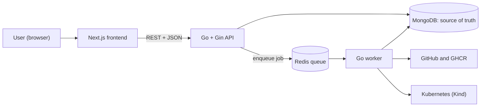

# ShipForge

A small, self-hostable deployment platform. Connect a GitHub repository, click **Deploy**, and watch your app get tested, built, shipped to Kubernetes and health-checked, with live status and logs in one dashboard.

> **Status:** MVP in development. Project type: Internal Developer Platform (IDP) / Platform Engineering. Team: 2 people.

## What problem does it solve?

Getting code from GitHub to a running app takes many manual steps (test, scan, build a Docker image, push it, deploy it, check it). Status and logs end up scattered across GitHub Actions, a registry and Kubernetes tools.

ShipForge is a **control panel** that coordinates those existing tools and shows everything in one place. It does **not** replace them. We are not building a new CI engine, cloud provider or Kubernetes.

## The MVP in one sentence

A signed-in user connects a repo, clicks Deploy, follows the stages (queued → building → deploying → healthy), and sees clear logs if something fails.

## How it works (big picture)



1. The **frontend** shows pages and sends requests. It never makes security decisions.
2. The **API** checks who you are and what you may do, saves a record, and puts a job on the queue. It never runs long tasks.
3. The **worker** takes jobs from the queue and does the slow work: checkout, test, scan, build, push, deploy, health check.
4. **MongoDB** keeps all records. **Redis** only carries jobs.

Read [docs/architecture/overview.md](docs/architecture/overview.md) next for details.

## Tech stack

| Layer | Choice |
|---|---|
| Frontend | Next.js + TypeScript |
| Backend API | Go + Gin |
| Worker | Go + Asynq |
| Database | MongoDB |
| Queue / cache | Redis |
| CI | GitHub Actions |
| Registry | GHCR |
| Runtime | Docker + Kind (local Kubernetes) |
| Packaging | Plain manifests first, Helm later |

## Repository layout

```text
shipforge/
├── apps/
│   └── web/                     # Next.js frontend
├── services/
│   └── api/                     # Go + Gin HTTP API
├── workers/
│   └── deployment-worker/       # Go background worker
├── internal/                    # Shared business modules (Go)
│   ├── auth/
│   ├── projects/
│   ├── integrations/
│   ├── pipelines/
│   ├── deployments/
│   └── audit/
├── pkg/                         # Shared helpers (Go)
│   ├── config/
│   ├── database/
│   ├── queue/
│   └── logger/
├── deploy/
│   ├── docker/
│   ├── kubernetes/
│   └── helm/
├── .github/
│   └── workflows/
├── docs/                        # You are here
├── docker-compose.yml
└── README.md
```

## Documentation map

Read in this order if you are new:

| # | Document | Read it to understand |
|---|---|---|
| 1 | [docs/architecture/overview.md](docs/architecture/overview.md) | The components and what each one may and may not do |
| 2 | [docs/architecture/deployment-flow.md](docs/architecture/deployment-flow.md) | What happens after the user clicks Deploy |
| 3 | [docs/architecture/data-model.md](docs/architecture/data-model.md) | MongoDB collections and example documents |
| 4 | [docs/api/api-contract.md](docs/api/api-contract.md) | Endpoints, JSON shapes, status values, error format |
| 5 | [docs/team/ownership.md](docs/team/ownership.md) | Who builds what, and how we work together |
| 6 | [docs/roadmap.md](docs/roadmap.md) | Milestones, dates and "definition of done" |
| 7 | [docs/security.md](docs/security.md) | Security rules we follow from day one |
| 8 | [docs/decisions/](docs/decisions/README.md) | Why we made key technical choices |
| 9 | [docs/glossary.md](docs/glossary.md) | Plain-English meaning of every term |
| 10 | [CONTRIBUTING.md](CONTRIBUTING.md) | Branches, pull requests, reviews |

## Local setup

> TODO (week 1): one command to run everything locally (`docker compose up`), plus the environment variables each service needs. Update this section as soon as it works.

## Team

| Person | Track |
|---|---|
| _Name 1_ | Backend and platform (Go API, MongoDB, worker, integrations) |
| _Name 2_ | Frontend and product (Next.js, dashboard, UX) |
| Both | DevOps and cloud (Docker, CI, Kubernetes), architecture, testing, docs |
