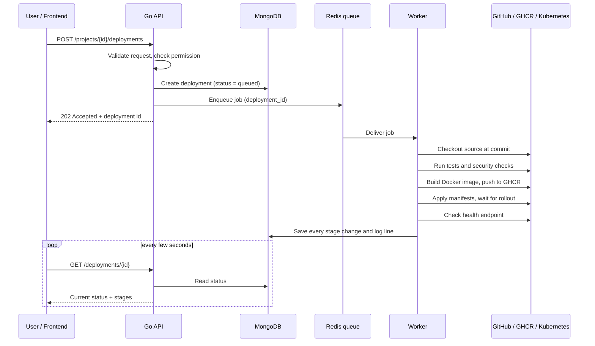
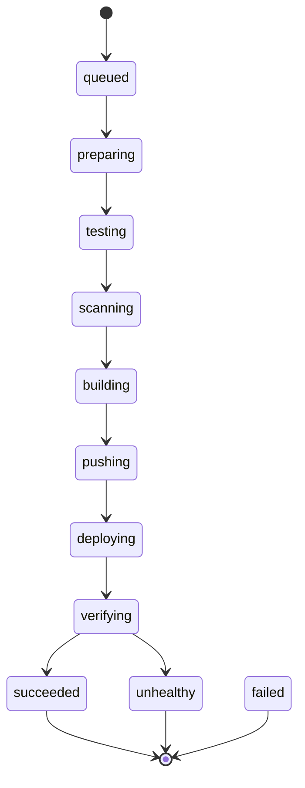

# Deployment flow

This is the most important page. It explains what happens from the moment a user clicks **Deploy** to the moment the dashboard says **healthy** (or **failed**).

## Sequence

## The steps in plain words

| # | Step | What happens | Result |
|---|---|---|---|
| 1 | Request | Frontend sends a POST with the project and environment | API validates and checks permission |
| 2 | Record | API creates a deployment document | `status = queued` |
| 3 | Enqueue | API puts a job (deployment ID + minimal refs) on the queue | Worker can pick it up later |
| 4 | Checkout | Worker gets the source code at a specific commit | Checkout stage recorded |
| 5 | Validate | Run tests and security checks | A failure stops the flow and records the reason |
| 6 | Build | Build a Docker image with a traceable tag, capture the digest | Image built |
| 7 | Publish | Push the image to GHCR with a narrowly scoped credential | Image reference saved on the deployment |
| 8 | Deploy | Apply Kubernetes manifests (Helm later) | Cluster resources updated |
| 9 | Verify | Check rollout status and the app's health endpoint | `succeeded`, `failed` or `unhealthy` |
| 10 | Notify | Frontend polls for updates (SSE/WebSocket later if needed) | User sees stages and logs |

## Status lifecycle

A deployment can move to `failed` from **any** in-progress stage, which the diagram leaves out to stay readable. Never jump straight from `queued` to `succeeded`.

| Status | Meaning |
|---|---|
| `queued` | Record created, waiting for a worker |
| `preparing` | Checking out the source |
| `testing` | Running tests |
| `scanning` | Running security checks |
| `building` | Building the Docker image |
| `pushing` | Pushing the image to GHCR |
| `deploying` | Applying Kubernetes resources |
| `verifying` | Waiting for rollout and health check |
| `succeeded` | Rollout finished and health check passed |
| `unhealthy` | Rollout finished but the health check failed |
| `failed` | A stage failed (see `failed_stage` and `error_summary`) |

> The exact status names are a **shared contract**. They live in [api-contract.md](../api/api-contract.md). Change them in one place only, via a pull request that both of us review.

## What we store when something fails

- `failed_stage` (for example `testing`)
- `error_summary` (short, human-readable, no secrets)
- timestamps for each stage (start, end, duration)
- `retry_count`

The frontend uses these to show a useful failure screen with the relevant logs.

## Reliability rules for background jobs

1. **MongoDB is the source of truth;** Redis/Asynq is only the delivery mechanism.
2. **Jobs must be idempotent.** Retrying the same deployment job must not create duplicate or conflicting deployments.
3. **Persist state first.** Save each state transition in MongoDB, and acknowledge the job only after it is safely recorded.
4. **Bounded retries with backoff.** Do not retry permanent failures forever.
5. **Reconciliation.** Add a process that finds deployments stuck in an in-progress state after a worker crash and fixes or fails them.
6. **Small payloads.** No large logs and no secrets in Redis job payloads. Pass IDs.

### Idempotency, simply

If the worker crashes after pushing the image but before saving that fact, the job is retried. The retry must notice "this deployment already has an image" and continue, instead of building a second image or creating a second deployment. A simple technique: check the deployment's saved state at the start of every stage and skip stages already marked done.

## Open decision

Who builds the Docker image in the MVP: the worker directly, or a GitHub Actions workflow the worker triggers? See [ADR 0003](../decisions/0003-image-build-approach.md).
