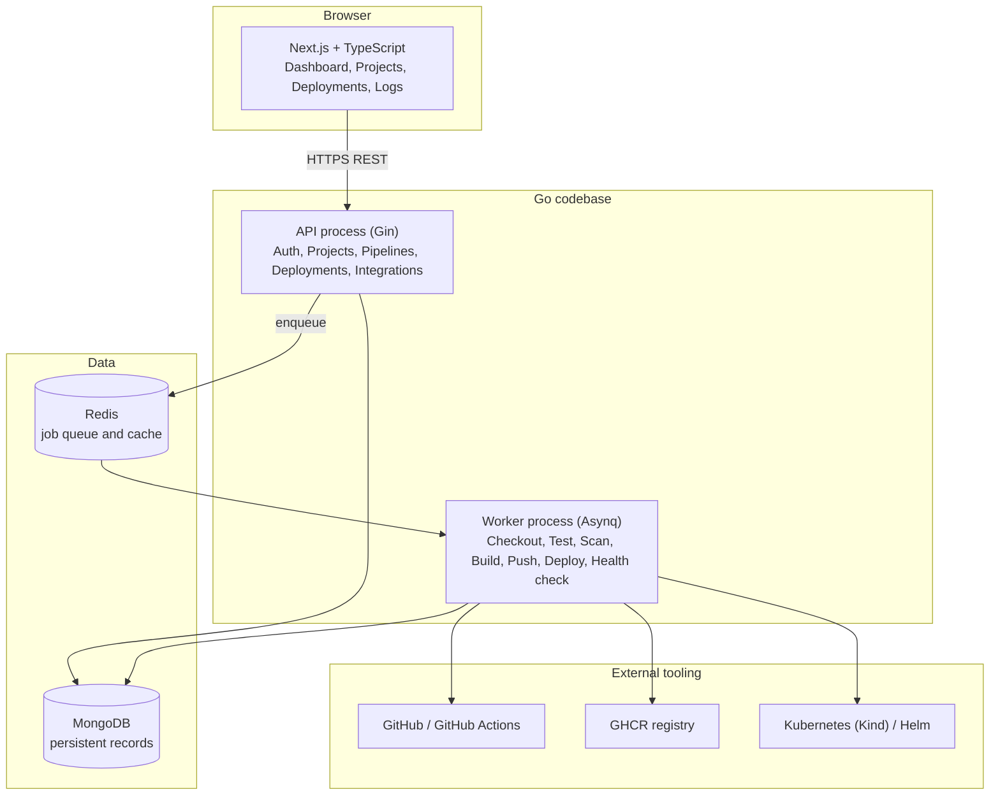

# Architecture overview

## The big idea

ShipForge is a **modular monolith** plus a **background worker**:

- One Go codebase with clear business modules (auth, projects, integrations, pipelines, deployments, audit).
- Two separate **processes** built from that codebase: the **API** and the **worker**.
- A separate **Next.js** frontend.

Why not microservices? For a two-person MVP, many independently deployed services mean much more setup, debugging and networking, with no real benefit yet. A modular monolith keeps things simple, and the module boundaries still let us split a service out later.

Why a separate worker? Building and deploying takes minutes. If the API did that work, requests would hang and the dashboard would freeze. The API answers quickly and hands the slow work to the worker through a queue.

## Component diagram



## What each component does, and must not do

| Component | Responsibility | Must NOT |
|---|---|---|
| **Next.js frontend** | Dashboard, forms, project views, deployment progress, log display | Hold provider credentials or make authorization decisions |
| **Go + Gin API** | Validate requests, authenticate users, enforce permissions, create records, enqueue work, expose status | Run long builds or arbitrary repository scripts in the API process |
| **MongoDB** | Store users, projects, integration metadata, pipeline runs, deployments, logs, audit events | Be the only job-execution mechanism without recovery logic |
| **Redis + Asynq** | Queue background jobs, retries, optional caching | Be the permanent source of truth for deployment history |
| **Go worker** | Consume jobs and coordinate isolated build/test/scan/deploy steps | Run untrusted code with unrestricted host or cloud credentials |

## Golden rules

1. **MongoDB is the truth.** Redis only delivers jobs. If Redis is wiped, we can rebuild the queue from MongoDB.
2. **Jobs carry IDs, not data.** A queue payload holds `deployment_id` and small metadata. Never logs, never secrets.
3. **Authorization lives in the backend.** Hiding a button in the UI is not security.
4. **The API never does slow work.** It records, enqueues and returns.
5. **Every state change is saved.** The worker writes each stage transition to MongoDB before moving on.

## Suggested code structure inside a module

Each module under `internal/<module>/` follows the same shape, so both of us know where to look:

```text
internal/deployments/
├── handler.go       # HTTP layer (used by the API only): parse request, call service, return JSON
├── service.go       # Business rules: permissions, state transitions
├── repository.go    # MongoDB reads and writes
├── model.go         # Structs
└── jobs.go          # Queue job definitions (shared by API and worker)
```

Dependency direction: `handler → service → repository`. Lower layers never import upper ones, and modules talk to each other through their service, not by reaching into each other's repositories.

## Where does a new feature go?

| Feature | Where |
|---|---|
| New page or UI component | `apps/web` |
| New endpoint | `internal/<module>/handler.go`, wired in `services/api` |
| New background stage (e.g. image scan) | `workers/deployment-worker`, using `internal/pipelines` |
| Shared helper (logger, config) | `pkg/` |
| Kubernetes manifest or Dockerfile | `deploy/` |

## Scope boundaries

Build now: one ShipForge instance, basic roles, project CRUD, GitHub connection, manual deploy, one worker, Redis queue, MongoDB records, Docker build, GHCR push, one Kind cluster, logs and health checks.

Defer: microservices, Kafka, multi-region, multi-cloud, autoscaling, cost analytics, DORA dashboards, policy-as-code, preview environments, enterprise SSO, multi-cluster management.
